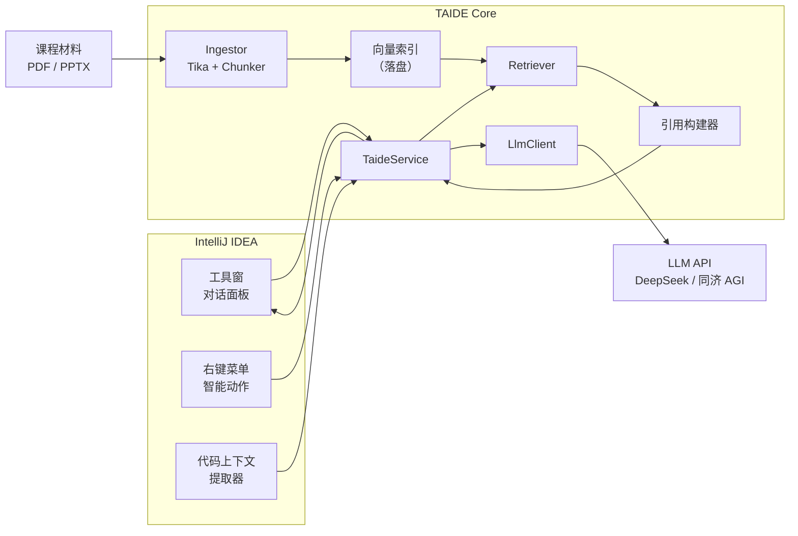

<div align="center">


<h1>TAIDE · 住在 IDE 里的课程助教</h1>

<p>
<b>面向 CST3492 的 IntelliJ IDEA 插件</b><br/>
用带引用的 RAG 回答课程问题，顺手把 JUnit 测试和提交信息也写了
</p>

<p>
  
  
  
  
</p>

<p>
  <a href="#-这是什么">这是什么</a> ·
  <a href="#-功能">功能</a> ·
  <a href="#-技术栈">技术栈</a> ·
  <a href="#-架构">架构</a> ·
  <a href="#-rag-管道">RAG 管道</a> ·
  <a href="#-快速开始">快速开始</a> ·
  <a href="docs/TEAM.md">分工与协作</a>
</p>

</div>

> [!IMPORTANT]
> **当前状态：B 组界面与选区上下文首版已实现，仍待全组集成。**
> B 负责的工具窗、流式聊天 UI、引用展示、右键代码上下文、项目设置和索引重建适配首版已落地；UI 可脱离 IDE 独立渲染检查，插件沙箱启动和全组集成尚待验证。
> 演示模式只返回标记过的固定示例；真实问答、课件索引和 C 组自动化动作尚待各负责人接入和端到端验收。最后更新：2026-10-23。

---

## 💡 这是什么

TAIDE 是一个**课程专属的助教**，装在 IntelliJ IDEA 里，为 *CST3492 — Java 企业级应用开发*（2026/27 学年第一学期，B 组）服务。

通用聊天机器人靠训练数据回答，助教得**照着课件回答**，而且要能拿出证据。TAIDE 把课程材料预处理成可检索的知识块，针对每个问题召回真正相关的那几段，再逼模型标注出处。当课件里确实没有相关内容时，它会明说，而不是编一个。

在此之上，它还自动化三件重复劳动：按一句自然语言需求写 JUnit 测试、读暂存区 diff 生成 Conventional Commit 提交信息、以及**对照课件规范审查代码**。

---

## ✨ 功能

### F0 — 核心助教（全组必做）

| | 功能 | 说明 | 状态 |
|:--|:--|:--|:--:|
| **F0.1** | 🔍 **RAG 问答** | 课件切块建索引，每个问题召回 top-k 相关片段，作为上下文喂给 LLM | 🟡 A 实现中 |
| **F0.2** | 📌 **来源引用** | 每个有依据的回答都标注 `文档 · 页码`；无依据时显式标注「基于通用知识，未引用课件」 | 🟡 UI 就绪，待接真实服务 |
| **F0.3** | 💬 **工具窗界面** | 停靠在 IDE 里的对话面板：消息历史、流式输出、可点击的引用卡片 | 🟡 B 首版待 IDE 启动验收 |
| **F0.4** | 🖱️ **上下文感知** | 选中代码右键 → *Ask TAIDE about this code*，选区内容自动注入提示词 | 🟡 B 首版待 IDE 启动验收 |

### F1 — 智能动作（Group B 范围，由 C 组负责实现）

| | 功能 | 说明 | 状态 |
|:--|:--|:--|:--:|
| **F1.1** | 🧪 **JUnit 测试生成** | 弹窗收一句自然语言场景（「用户 ID 不存在」），结合选中的类/方法生成 JUnit 5 测试类，写入 `src/test/java` | ⚪ C 待集成 |
| **F1.2** | 📝 **提交信息生成** | 读取暂存区 diff，判断语义意图（feat / fix / refactor），按 Conventional Commits 起草，可编辑后提交 | ⚪ C 待集成 |
| **F1.3** | 🎓 **课件感知代码审查** | *自创动作。* 对照**课件讲授的规范**审查选中的代码，每条问题都带课件引用 | ⚪ C 待集成 |

<sub>⚪ 待开始 / 待集成 · 🟡 进行中或等待集成 · 🟢 当前负责人首版已完成；全组端到端验收另计</sub>

**为什么把 F1.3 定为自创动作。** 另外两个自动化是通用的，市面上已有。而「指出这段代码违反了第 4 讲第 17 页讲的写法，并附上那一页」——没有现成工具能做到。它复用了已经建好的 RAG 管道，边际成本低；演示时观众可以当场打开被引用的那一页核对，这是最有说服力的一个功能。

---

## 🛠️ 技术栈

<h3 align="center">运行时与平台</h3>

<p align="center">
  
  
  
</p>

<h3 align="center">RAG 与模型</h3>

<p align="center">
  
  
  
  
</p>

<h3 align="center">工程与测试</h3>

<p align="center">
  
  
  
</p>

---

## 🏗️ 架构



**三个可以拿去答辩的设计决策：**

1. **页边界不可跨越。** 切块永远不跨页，因此每个块都携带精确的 `(文件, 页码)`。这是引用既便宜又诚实的原因——反过来，先按固定窗口切全文、事后再还原页码，只会得到一堆对不上的出处。
2. **嵌入在本地跑。** `all-MiniLM-L6-v2` 以 ONNX 形式随插件分发。不需要 embedding API Key，没有按次计费，断网也能演示。唯一的网络依赖是 LLM 调用。
3. **索引是一个文件，不是数据库。** 几千个块完全可以放进内存。序列化成 JSON 落到插件配置目录，构建简单，整条管道用文本编辑器就能检查。如果语料真的涨到装不下，换 SQLite 即可——`VectorIndex` 接口就是那道缝。

---

## 🔬 RAG 管道

| 阶段 | 做法 | 说明 |
|:--|:--|:--|
| **1. 解析** | Apache Tika，逐页解析 | PDF 取页面框；PPTX 逐张幻灯片取文本，含备注 |
| **2. 切块** | 页内递归切分，目标 **512 token**，重叠 **64** | 绝不跨页——保住引用的粒度 |
| **3. 嵌入** | `all-MiniLM-L6-v2`（ONNX，384 维），批量 + 按内容哈希缓存 | 离线可跑，CPU 上约 5 ms/块 |
| **4. 索引** | 内存中的余弦相似度存储，JSON 持久化 | 按文件 mtime + 哈希判断是否需要重建 |
| **5. 检索** | top-k = 8 → 相似度阈值 0.35 → **MMR**（λ = 0.7）去重 | 阈值在 20 题评测集上调出来 |
| **6. 判定** | top-1 分数低于阈值 → 进入「通用知识」模式，不输出引用 | 防止编造出处 |
| **7. 引用** | 块元数据 → `[第 05 讲 · 第 12 页]`，可点击打开源 PDF | 引用由元数据生成，**绝不交给模型写** |

---

## 🚀 快速开始

当前可独立运行的是 B 模块演示沙箱，需 JDK 21；首次构建会下载 Gradle 和 IntelliJ 平台依赖。

```powershell
# 1. 克隆
git clone https://github.com/Keith-hq/taide.git
cd taide

# 2. 运行不依赖 IDE SDK 的行为检查，并生成原生 Swing 预览
.\tools\verify-b.ps1 -JavaHome 'C:\path\to\jdk-21'

# 3. 配置 JDK，启动带 B 模块的隔离 IDE
$env:JAVA_HOME = 'C:\path\to\jdk-21'
.\tools\b-sandbox\run.ps1 runIde
```

详细说明见 [B 沙箱运行指南](tools/b-sandbox/README.md)。当前沙箱默认使用固定示例回答；真实模型、课件索引及 C 的动作需集成后验收。根目录正式构建由 C 提供。

**集成后配置模型** —— *Settings → Tools → TAIDE*：

| 字段 | 值 |
|:--|:--|
| Provider | `DeepSeek` / `AGI（同济）` |
| API Key | 你自己的 Key |
| Model | `deepseek-chat` |
| 课件目录 | 存放讲义 PDF/PPTX 的文件夹 |

然后在设置页点 **Rebuild Knowledge Base**。10 份讲义首次建索引约 30 秒，之后走缓存。

> 插件**不内置**任何 API Key，也**不附带**课程材料，两者都由使用者本地提供。

---

## 📁 目录结构

```
taide/
├── src/main/java/edu/cst3492/taide/
│   ├── rag/            # 摄取 · 切块 · 嵌入 · 索引 · 检索
│   ├── llm/            # 各家客户端、提示词模板
│   ├── ui/             # 工具窗、对话面板、引用卡片
│   ├── action/         # 右键动作（F0.4 + F1）
│   ├── git/            # 暂存区 diff 提取
│   ├── settings/       # 插件持久化配置
│   └── service/        # TaideService —— UI 与内核之间唯一的接缝
├── src/main/resources/
│   ├── META-INF/plugin.xml
│   └── prompts/        # 带版本的提示词模板
├── docs/
│   ├── TEAM.md         # 分工方案 —— 我们真正照着执行的那份文档
│   └── ARCHITECTURE.md
└── build.gradle.kts
```

---

## 👥 团队

| | 角色 | 负责 |
|:--|:--|:--|
| **A** | RAG 与模型内核 | 摄取、切块、检索、提示词、引用 |
| **B** | UI/UX 与上下文 | 工具窗、对话面板、右键菜单、`plugin.xml` |
| **C** | 自动化与发布 | F1 三个动作、Git 集成、CI、打包 |

完整职责、接口契约、里程碑与协作约定见 **[docs/TEAM.md](docs/TEAM.md)**。

---

## 🗺️ 里程碑

| 日期 | 节点 |
|:--|:--|
| 10-22 | 接口契约冻结（v1.0） |
| 10-26 | **集成 #1** —— F0 端到端跑通，带引用 |
| 10-30 | **集成 #2** —— F0 + F1 全部打通 |
| 11-01 | 报告与幻灯片初稿完成，插件打包 |
| 11-03 23:00 | **提交截止** |
| 11-04 13:30 | 课堂演示 |

---

<div align="center">

**CST3492 — Java 企业级应用开发** · 2026/27 学年第一学期 · B 组

用 ☕ 和数不清的 `gradlew runIde` 写成。

</div>
