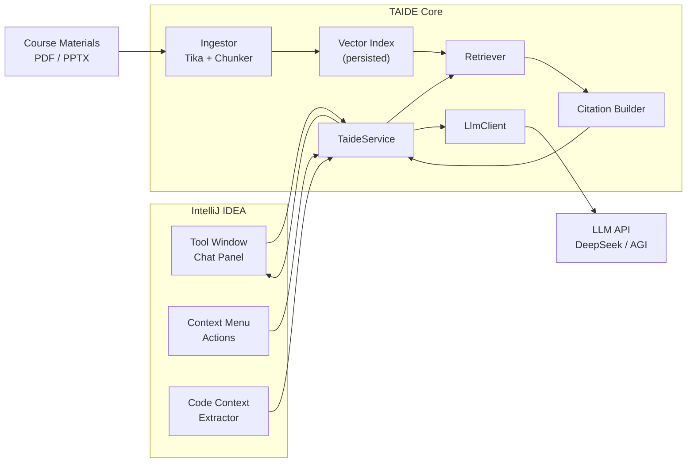

<div align="center">


**An IntelliJ IDEA plugin that answers Java EE course questions with RAG-grounded citations — and automates the boring parts of writing code.**

<p>
  
  
  
  
</p>

<p>
  
  
  
  
  
</p>

<p>
  <a href="#-quick-start"><b>Quick Start</b></a> ·
  <a href="#-architecture"><b>Architecture</b></a> ·
  <a href="#-rag-pipeline"><b>RAG Pipeline</b></a> ·
  <a href="docs/TEAM.md"><b>Team &amp; Ownership</b></a>
</p>

</div>

> [!IMPORTANT]
> **Project status: scaffolding.** This repository currently contains the design, the division of work, and the build skeleton. Every feature below is either *planned* or *in progress* — nothing is finished yet. The status column in the feature table is the source of truth. Last updated: 2026-10-21.

---

## 📖 What is TAIDE?

TAIDE is a **course-specific teaching assistant** that lives inside IntelliJ IDEA. It is built for *CST3492 — Java Enterprise Application Development* (AY 2026/27 Semester 1, Group B).

A general-purpose chatbot answers from generic training data. A TA has to answer **from the lecture slides** — and prove it. TAIDE pre-processes the course materials into searchable chunks, retrieves the ones that actually matter for your question, and forces the model to cite the source document and slide number. When nothing relevant exists, it says so instead of bluffing.

On top of that, it automates three repetitive tasks: writing JUnit tests from a one-line requirement, drafting Conventional Commit messages from staged diffs, and reviewing code against the conventions taught in class.

---

## ✨ Features

### F0 — Core Teaching Assistant *(all groups)*

| | Feature | What it does | Status |
|:--|:--|:--|:--:|
| **F0.1** | 🔍 **RAG-grounded Q&A** | Chunks and indexes course materials, retrieves the top-k relevant passages for every question, and feeds them to the LLM as context | 🟡 |
| **F0.2** | 📌 **Source citation** | Every grounded answer cites `document · slide/page`. Ungrounded answers are explicitly labelled *"general knowledge — no course material referenced"* | ⚪ |
| **F0.3** | 💬 **Tool window UI** | A chat panel docked in the IDE: message history, streaming output, clickable citation cards | 🟡 |
| **F0.4** | 🖱️ **Context awareness** | Right-click any selection → *Ask TAIDE about this code*. The selected code is injected into the prompt | ⚪ |

### F1 — Smart Actions *(Group B only)*

| | Feature | What it does | Status |
|:--|:--|:--|:--:|
| **F1.1** | 🧪 **JUnit test generation** | Prompts for a natural-language scenario ("user ID does not exist"), combines it with the selected class/method, generates a JUnit 5 test class and writes it into `src/test/java` | ⚪ |
| **F1.2** | 📝 **Commit message generator** | Reads the staged diff, infers the semantic intent (feat / fix / refactor), drafts a Conventional Commit message you can edit before committing | ⚪ |
| **F1.3** | 🎓 **Course-aware code review** | *Creative action.* Reviews selected code **against the lecture material** — flags deviations from the patterns taught in class, each finding backed by a citation | ⚪ |

<sub>⚪ planned · 🟡 in progress · 🟢 done</sub>

**Why F1.3 is the creative action.** The other two automations are generic. A code review that cites *Lecture 4, slide 17* is something no off-the-shelf tool can do — it reuses the RAG pipeline we already built, and it is the single best thing to demo, because the reviewer can open the cited slide and check whether the model is right.

---

## 🛠️ Tech Stack

<h3 align="center">Runtime &amp; Platform</h3>

<p align="center">
  
  
  
</p>

<h3 align="center">RAG &amp; LLM</h3>

<p align="center">
  
  
  
  
</p>

<h3 align="center">Tooling</h3>

<p align="center">
  
  
  
</p>

---

## 🏗️ Architecture



**Three design decisions worth defending in the viva:**

1. **Slide boundaries are sacred.** Chunks never cross a page boundary, so every chunk carries an exact `(file, slide)` pair. This is what makes citation cheap and honest — the alternative (fixed-size windows over the whole document) destroys page numbers and forces you to reconstruct them later.
2. **Embeddings run locally.** `all-MiniLM-L6-v2` on ONNX, bundled with the plugin. No embedding API key, no per-query cost, and the demo works with the network unplugged. The LLM call is the only network dependency.
3. **The index is a file, not a database.** A few thousand chunks fit comfortably in memory. Serialising to JSON under the plugin config directory keeps the build simple and makes the whole pipeline inspectable with a text editor. If the corpus ever outgrows this, swap in SQLite — the `VectorIndex` interface is the seam.

---

## 🔬 RAG Pipeline

| Stage | Approach | Notes |
|:--|:--|:--|
| **1. Parse** | Apache Tika, page-by-page | PDF → page boxes; PPTX → per-slide text, speaker notes included |
| **2. Chunk** | Recursive split inside a page, target **512 tokens**, **64 overlap** | Never spans pages — preserves citation granularity |
| **3. Embed** | `all-MiniLM-L6-v2` (ONNX, 384-d), batched + cached by content hash | Runs offline, ~5 ms/chunk on CPU |
| **4. Index** | Cosine similarity over an in-memory store, JSON-persisted | Rebuild on material change, keyed by file mtime + hash |
| **5. Retrieve** | top-k = 8 → score threshold 0.35 → **MMR** (λ = 0.7) to drop near-duplicates | Threshold tuned on a 20-question eval set |
| **6. Ground** | If top-1 score < threshold → *general knowledge* mode, no citations | Prevents fabricated references |
| **7. Cite** | Chunk metadata → `[Lecture 05 · Slide 12]`, clickable, opens the source PDF | Citations are generated from metadata, never from the model |

---

## 🚀 Quick Start

```bash
# 1. Clone
git clone https://github.com/Keith-hq/taide.git
cd taide

# 2. Build (JDK 21 required)
./gradlew buildPlugin

# 3. Run a sandbox IDE with the plugin installed
./gradlew runIde
```

**Configure the model** — *Settings → Tools → TAIDE*:

| Field | Value |
|:--|:--|
| Provider | `DeepSeek` / `AGI (Tongji)` |
| API Key | your key |
| Model | `deepseek-chat` |
| Course materials | folder containing the lecture PDFs/PPTX |

Then click **Rebuild Knowledge Base** in the settings page. First build takes ~30 s for 10 lectures; afterwards it is cached.

> The plugin ships **without** any API key and **without** the course materials. Both are supplied locally by the user.

---

## 📁 Project Structure

```
taide/
├── src/main/java/edu/cst3492/taide/
│   ├── rag/            # ingest · chunk · embed · index · retrieve
│   ├── llm/            # provider clients, prompt templates
│   ├── ui/             # tool window, chat panel, citation cards
│   ├── action/         # context-menu actions (F0.4 + F1)
│   ├── git/            # staged-diff extraction
│   ├── settings/       # persistent plugin settings
│   └── service/        # TaideService — the single seam between UI and core
├── src/main/resources/
│   ├── META-INF/plugin.xml
│   └── prompts/        # versioned prompt templates
├── docs/
│   ├── TEAM.md         # division of work — the document we actually run on
│   └── ARCHITECTURE.md
└── build.gradle.kts
```

---

## 👥 Team

| | Role | Owns |
|:--|:--|:--|
| **A** | RAG &amp; LLM Core | ingestion, chunking, retrieval, prompting, citations |
| **B** | UI/UX &amp; Context | tool window, chat panel, context menu, `plugin.xml` |
| **C** | Automation &amp; Release | the three F1 actions, Git integration, CI, packaging |

Full responsibilities, interface contracts, milestones and working agreements: **[docs/TEAM.md](docs/TEAM.md)**

---

## 🗺️ Milestones

| Date | Milestone |
|:--|:--|
| 10-22 | Interface contract frozen (v1.0) |
| 10-26 | **Integration #1** — F0 end-to-end with citations |
| 10-30 | **Integration #2** — F0 + F1 complete |
| 11-01 | Report + slides drafted, plugin packaged |
| 11-03 23:00 | **Submission deadline** |
| 11-04 13:30 | Presentation |

---

<div align="center">

**CST3492 — Java Enterprise Application Development** · AY 2026/27 Semester 1 · Group B

Made with ☕ and far too many `gradlew runIde` cycles.

</div>
