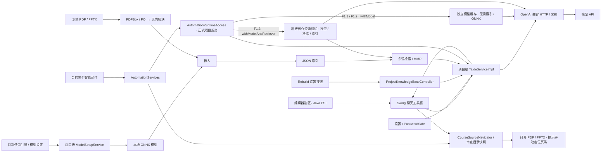

<div align="center">


<h1>TAIDE · 住在 IDE 里的课程助教</h1>

<p><b>面向 CST3492 的 IntelliJ IDEA 插件</b><br/>检索课程材料、流式问答，并在编辑器中执行智能动作</p>

<p>
  
  
  
  
</p>

<p>
  <a href="#-这是什么">这是什么</a> ·
  <a href="#-功能与当前状态">功能</a> ·
  <a href="#-技术栈">技术栈</a> ·
  <a href="#-架构">架构</a> ·
  <a href="#-快速开始">快速开始</a> ·
  <a href="docs/TEAM.md">分工与协作</a>
</p>

</div>

> [!IMPORTANT]
> **当前状态：F0 与 F1 三个智能动作均已在代码中接入正式项目服务，正在进行实机验收与交付准备。** 最新核查基线为 `main` 的 `525b9e0`，最后更新：2026-10-26。
> 聊天默认开启演示模式，返回明确标注的固定示例。真实课程问答需要检索模型、课件索引和有效 API Key，并由用户显式关闭演示模式。F1 动作使用实际配置的 API，不由聊天演示模式提供固定答案。
> [六项 Windows IDEA 验收](docs/e2e/E2E_RESULTS.md)仍为 `E2E_NOT_RUN`；代码接通与 CI 通过不代表人工验收完成。操作步骤见 [验收指南](docs/e2e/E2E_GUIDE.md)和 [六项真实场景 Word 操作文档](docs/TAIDE-Windows-IDEA六项真实场景验收操作文档-V1.0.0.docx)。

---

## 💡 这是什么

TAIDE 为 **CST3492 — Java 企业级应用开发**（2026/27 学年第一学期，Group B）提供 IDE 内的课程助教。它从本地 PDF/PPTX 检索相关片段，再调用兼容 OpenAI API 的模型生成回答；引用卡片中的文档与页码来自检索元数据。检索未命中时，回答进入通用知识模式，引用列表为空。

编辑器选区可以附带文件路径、语言、行号与所属类送入对话。智能动作另外提供 JUnit 测试生成、Conventional Commit 提交信息生成与课件感知代码审查。

## ✨ 功能与当前状态

| 范围 | 功能 | 当前代码与使用边界 |
|:--|:--|:--|
| **F0.1** | 课程 RAG 问答 | PDF/PPTX 摄取、切块、ONNX 嵌入、JSON 索引、检索与流式客户端已实现；真实模式需准备模型、索引和凭据 |
| **F0.2** | 来源引用 | 显示文档、1-based 页码、命中片段与真实检索分数；演示引用标记为示例且隐藏虚构分数；打开文件后提示手动定位页码 |
| **F0.3** | 原生聊天工具窗 | 右侧 TAIDE 面板，消息历史、流式输出、代码块复制、停止生成、重试与新会话；每条消息保留发送时的演示/真实来源与课件目录 |
| **F0.4** | 选区上下文 | 选中代码右键 → `Ask TAIDE about This Code`；无选区时置灰，Java 文件补充所属类 |
| **首次使用** | 模型准备与引导 | 展示模型、API/课件与索引准备状态；用户点击后下载并校验模型，也可选择已有目录；不会自动退出演示模式 |
| **F1.1** | JUnit 测试生成 | 正式模型服务已接入；支持语法校验、可编辑预览、创建文件与撤销；无需课件索引或 ONNX，生成结果编译与运行待实机验收 |
| **F1.2** | 提交信息生成 | 正式模型服务已接入；支持暂存区差异、Conventional Commit 预览、复制与确认后本地提交；无需课件索引或 ONNX，真实仓库操作待验收 |
| **F1.3** | 课件感知代码审查 | 复用聊天的模型、检索器与索引，结构化问题、引用核验和默认来源导航已接入；真实课件审查与文件预览待验收 |

**引用定位边界：** 当前通过 IDE 打开本地源文件，并显示页码提示。PDF/PPTX 能否直接预览取决于本机 IDE 的文件处理能力；尚未实现跳转到指定页的深链。演示引用只显示说明，不会打开同名真实课件。

每条历史消息使用发送时保存的课件目录打开引用。之后切换设置中的目录或演示模式，不会把已有引用指向新目录中的同名文件。

课件审查使用项目级 `CourseSourceNavigator`，无需先打开聊天工具窗或调用 `bind`。`CourseReviewAction` 在启动后台审查前通过 `AutomationServices.captureSourceOpener()` 保存导航回调：默认固定当时的课件目录，已有自定义绑定时固定该回调。来源按钮传入原始 `RetrievedChunk`，打开目录内的 PDF/PPTX 后提示手动定位到对应的 1-based 页码；后续设置或绑定变更不会替换旧审查持有的回调。自定义回调自身负责保存所需的目录上下文。

### 集成核查结果

核查以 `main` 的 `525b9e0`（2026-10-26）为基线，包含来源导航、A 的共享运行时和 C 的正式动作接入。下表的“代码已接通”表示正式插件入口和调用路径已连接；实际 IDE 中使用有效 API Key、真实课件完成操作，仍须单独验收。

| 链路 | 当前结论 | 依据与剩余工作 |
|:--|:--|:--|
| 首次引导 → 模型下载/已有目录 → 校验 → 模型加载 | 代码已接通 | `ModelSetupService` 管理共享目录，问答与重建使用同一路径；真实模型安装、校验、缓存复用和推理已验证，IDE 内联网下载待人工验收 |
| 课件目录 → Rebuild → 本地索引 → 聊天检索 | 代码已接通 | `ProjectKnowledgeBaseController` 委托同一个 `TaideServiceImpl`；重建成功使聊天资源缓存失效 |
| 普通提问/编辑器选区 → 检索 → API → 流式回答 | 代码已接通 | 正式工具窗解析项目问答服务，设置与 PasswordSafe 提供连接参数；完整 IDE 操作链仍需真实环境验收 |
| 聊天引用 → 源文件 → 指定页 | 部分完成 | 已检查引用路径并打开文件；指定页深链未实现，当前提示手动定位 |
| F1.1 JUnit 生成 → 预览 → 写入/撤销 | 代码已接通 | `AutomationServices.withModel` 调用正式项目服务；需验证生成测试可编译、可运行及取消不写入 |
| F1.2 暂存区 → 提交信息 → 预览/本地提交 | 代码已接通 | `withModel` 使用已保存的连接配置与凭据；需在独立临时仓库验证确认提交、暂存区边界与未暂存文件保留 |
| F1.3 代码审查 → 课件检索 → 引用导航 | 代码已接通 | `withModelAndRetriever` 取得聊天核心的资源租约；审查前固定来源目录或自定义回调，需验证真实发现与引用打开 |
| PR → CI 测试/打包 → 兼容检查 | CI 已通过 | `525b9e0` 的 [Build and Test](https://github.com/Keith-hq/taide/actions/runs/40275125811) 中 `build`、`compatibility` 均成功；不包含 IDE 人工验收 |

**F1 的正式服务来源：** 已注册的 `TaideServiceImpl` 实现 `AutomationRuntimeAccess`。F1.1/F1.2 通过 `withModel` 使用独立缓存的模型客户端，与聊天共享连接配置和凭据机制，不要求课件索引或加载 ONNX；F1.3 通过 `withModelAndRetriever` 复用聊天核心的模型、检索器和索引，并在回调期间持有资源租约。无需额外注册 `LlmClient` / `Retriever` 或手动调用 `bind`；绑定接口保留给测试及定制场景。详见 [自动化服务接入](docs/AUTOMATION.md#服务接入)。

**剩余验收与交付：** 按 [E2E 指南](docs/e2e/E2E_GUIDE.md)执行六个场景，将实际构建 commit、安装包 SHA-256、结果与截图填入 [验收台账](docs/e2e/E2E_RESULTS.md)。另需核验界面主题、缩放、窄面板和下载失败等异常状态；A 补齐 AGI 实际连接及课件页码抽检，全组完成英文报告、演示材料、干净机器安装与彩排。现有组件测试不能替代这些验收。

## 🛠️ 技术栈

| 层次 | 实际采用 | 用途 |
|:--|:--|:--|
| 运行与构建 | **JDK 21**、根 Gradle Wrapper **8.13**、IntelliJ Platform Gradle Plugin **2.5.0** | 编译、测试、隔离 IDE、插件打包 |
| 目标平台 | IntelliJ IDEA Community **2024.2.4**，兼容范围 **242.\***，依赖 Java 插件 | 工具窗、项目服务、设置、编辑器与 Java PSI |
| 界面 | 原生 **Swing / IntelliJ UI** | 聊天面板、设置页、引用卡片与智能动作预览 |
| HTTP 与 JSON | JDK **java.net.http**、Gson **2.12.1** | OpenAI 兼容 `/chat/completions`、SSE 流式响应、索引序列化 |
| 材料解析 | PDFBox **3.0.5**、POI XSLF **5.4.1** | PDF 逐页、PPTX 逐张幻灯片提取文本与备注 |
| 本地嵌入 | ONNX Runtime **1.20.0**、`all-MiniLM-L6-v2` | 384 维向量；模型不随插件打包，首次使用可按需下载或选择已有目录 |
| 索引 | 内存余弦检索、JSON 文件 | 内容哈希复用、阈值过滤、MMR 去重 |
| 自动化与测试 | JavaParser **3.26.3**、JGit **7.1.0**、JUnit **5.11.4** | 生成代码校验、暂存区操作、单元及 IntelliJ 平台测试 |
| 凭据 | IntelliJ **PasswordSafe** | API Key 按项目、Provider 与 API 端点隔离保存，不写入配置 XML |

## 🏗️ 架构



聊天、重建与 F1 通过同一个项目级服务提供能力。聊天与课件审查共享核心资源，JUnit 与提交信息生成使用单独的模型客户端缓存。设置或凭据更新会使后续访问使用新配置；重建成功后失效核心资源缓存，正在使用的旧资源等待租约释放后关闭。重建发布前检查取消状态，取消不会把未完成索引替换为当前索引；完成发布后的取消会如实显示已完成状态。

模型准备由应用级服务管理，所有项目共享已校验的文件，切换模型目录会使项目问答资源失效并在后续请求中重新加载。关闭设置页不会中断下载，可从 IDE 后台任务进度取消。

### RAG 管道

| 阶段 | 当前实现 |
|:--|:--|
| 解析与切块 | PDFBox / POI 保留 1-based 页码；不跨页切块，目标约 512 token、重叠约 64 token，长度使用估算 |
| 嵌入 | 本地 MiniLM ONNX，WordPiece 分词、均值池化与 L2 归一化，384 维 |
| 索引 | JSON 原子写入，按内容哈希复用旧向量；放在 IDE 配置目录 |
| 检索 | 问答请求最多 8 条，先取候选，再按 **0.45** 阈值过滤，使用 **λ=0.7** 的 MMR 去重 |
| 回答 | 命中片段参与提示词；无命中时 `grounded=false`、引用为空；流式 token 由 B 在 EDT 批量展示 |
| 引用 | 由召回块的文档、页码与片段构建卡片；模型输出仍需结合来源人工核对 |

性能和检索质量取决于本机硬件与材料；团队已记录的语料与评测结果见 [TEAM 中 A 的实现记录](docs/TEAM.md#51-a--rag--llm-core-lead)。

## 🚀 快速开始

### 1. 构建与启动正式插件

安装 JDK 21 后，在仓库根目录运行。首次执行需要网络下载 Gradle、IDE SDK 和依赖。

```powershell
git clone https://github.com/Keith-hq/taide.git
cd taide
$env:JAVA_HOME = 'C:\path\to\jdk-21'
.\gradlew.bat build buildPlugin verifyPluginStructure
.\gradlew.bat runIde
```

macOS/Linux 使用 `./gradlew`。安装包位于 `build/distributions/taide-0.1.0-SNAPSHOT.zip`，可在 IDEA 的 `Settings → Plugins → Install Plugin from Disk` 安装。二进制兼容性检查命令为 `.\gradlew.bat verifyPlugin`。

已有 **IDEA Community 2024.2.4（含 Java 插件）** 时，可给 Gradle 添加 `-PlocalPlatformPath=C:\path\to\idea` 复用安装；PyCharm 缺少所需 Java PSI，不能替代此 SDK。

### 2. 预览 B 界面与默认演示

无需 IDE SDK 的行为检查与原生 Swing 渲染：

```powershell
.\tools\verify-b.ps1 -JavaHome 'C:\path\to\jdk-21'
```

结果位于 `build/b-verification/`，14 张界面截图位于其 `screenshots/`。这会渲染实际 `ChatPanel`，覆盖窄停靠窗和 1366×768 等尺寸；不等于已在真实 IDE 中完成人工验收。

在启动的 IDE 中通过 `View → Tool Windows → TAIDE` 打开面板。默认勾选 `Use demo service`，聊天返回固定示例，支持检查流式显示、复制、取消和引用状态。演示模式不调用模型、不读取课件，也不替 C 的自动化动作提供服务。

[B 辅助沙箱](tools/b-sandbox/README.md)使用同一套源码与正式扩展注册，适合界面审查；根构建负责集成测试、正式安装包和兼容性检查。

### 3. 配置真实课程问答

1. 打开 `View → Tool Windows → TAIDE`。首次使用引导会展示检索模型、API/课件与知识库的准备状态；默认仍使用演示答案。
2. 点击 **下载并配置**，或在 `Settings → Tools → TAIDE → 本地检索模型` 中使用同名按钮。插件仅在点击后联网，在后台准备约 **90 MB** 的官方 `all-MiniLM-L6-v2` 模型 `model.onnx` 与词表 `vocab.txt`，显示下载进度并校验完整性。无需 PowerShell、环境变量或重新启动 IDE。
3. 已有模型时，在上述设置页点击 **使用已有目录…**，选择同时包含两个文件的目录并等待校验通过；需要切回插件管理的目录时点击 **使用默认目录**。已有文件须与插件固定版本匹配，仅有相同文件名不足以通过校验。
4. 把本地 PDF/PPTX 课件直接放在同一个可读文件夹中；当前摄取不递归扫描子目录，也不对扫描版 PDF 做 OCR。
5. 在 `Settings → Tools → TAIDE` 选择 Provider，填写 API base URL、Model ID、API Key 和 Course directory。DeepSeek 默认基址为 `https://api.deepseek.com`、模型为 `deepseek-chat`；AGI 使用学校提供的兼容基址和模型名称。
6. 点 **Apply** 保存配置，再点 **Rebuild Knowledge Base**。模型未就绪时重建按钮禁用。索引在后台构建并显示进度，可在发布新索引前取消；已完成的重建不会因取消设置对话框而撤销。
7. 准备完成后，在工具窗点击 **切换真实问答**；也可在设置页取消勾选 **Use demo service** 并点 **Apply / OK**。下载成功不会自动关闭演示模式。发送新问题检查引用；未命中时应显示通用知识提示且没有课件引用，已有演示历史继续标为示例。

引导中的 API 状态仅检查是否已填写合法的地址、模型名称及已保存的 Key，**不等于已验证网络连通、Key 有效或账户余额充足**。真实 API 是否可用，以发送问题后的实际响应为准。

#### 模型保存、离线使用与下载失败

下载来自 [sentence-transformers 官方 MiniLM 仓库的固定版本](https://huggingface.co/sentence-transformers/all-MiniLM-L6-v2/tree/1110a243fdf4706b3f48f1d95db1a4f5529b4d41)，采用 Apache 2.0 许可。插件按固定文件大小与 SHA-256 校验两个文件，成功后保存到 **`<IDE config>/taide/model/`**；同一 IDE 配置下所有项目共享，已校验的缓存可离线复用。下载文件不进入项目仓库，模型准备也不会替用户申请 API Key 或建立课件索引。

下载连接使用 IDE 的 HTTP Proxy 配置。若超时或连接失败，打开 **`Settings → Appearance & Behavior → System Settings → HTTP Proxy`**，按自己的网络环境配置后重试；也可从可联网的机器复制固定版本的完整模型目录，使用 **使用已有目录…**。下载可取消，未完整校验的文件不会被当作可用模型。

开发和 CLI 仍兼容 `TAIDE_MODEL_DIR` 环境变量与 `taide.model.dir` JVM 属性。**IDE 设置中显式选择的目录（包括“使用默认目录”）优先**；没有显式选择时，才依次读取 JVM 属性、环境变量和默认目录。环境变量只会被随后启动的 IDE 继承，普通用户无需设置它。

索引保存在 `<IDE config>/taide/index/<project-hash>.json`。API Key 保存在 PasswordSafe，按**项目 + Provider + 端点**隔离；切换到新的 API 端点需填写该端点的 Key。从旧版凭据存储升级后，也需重新输入一次 Key。Key 留空会保留当前端点已有凭据，删除需勾选对应的移除选项。

> 插件不内置 API Key、课程材料或嵌入模型。真实问题及选区代码会随请求发往你配置的模型服务；请先确认配置与发送内容。

### 4. 使用三个智能动作

先在 `Settings → Tools → TAIDE` 保存 Provider、API base URL、Model ID 与 API Key。F1 动作会使用这些配置调用真实 API，聊天的演示开关不控制 F1。

| 动作入口 | 前置条件与结果 |
|:--|:--|
| 选中 Java 代码 → 右键 `TAIDE → Generate JUnit Tests...` | 输入测试场景后生成可编辑预览，确认后保存测试文件；无需模型文件或课件索引，目标工程需自行配置 JUnit 5 依赖 |
| `Tools → TAIDE → Generate Commit Message...` | 项目需为 Git 仓库且已有暂存变更；先预览差异，再生成、编辑或复制消息，单独确认后才提交本地暂存区；无需课件索引 |
| 选中 Java 代码 → 右键 `TAIDE → Review Code Against Course...` | 需要本地检索模型与当前项目已建索引；显示结构化问题和经检索核验的引用，无命中时明确显示通用审查 |

生成与保存、Git 提交、真实课件审查的详细验收步骤见 [Windows E2E 指南](docs/e2e/E2E_GUIDE.md)。

### 5. 验证与协作

```powershell
# 默认跳过标为 live-model 的真实模型测试
.\gradlew.bat test

# 只执行 B 的 Java PSI 上下文平台测试
.\gradlew.bat test --tests '*CodeContextExtractorPlatformTest'
```

截至 2026-10-26，`main` 的 `525b9e0` 已通过 [CI run 40275125811](https://github.com/Keith-hq/taide/actions/runs/40275125811)：`build` 作业执行交付工具测试、Gradle 构建/测试、插件打包与结构验证、示例工程构建，`compatibility` 作业执行插件二进制兼容性检查。安装包、测试报告和兼容报告按该 commit 分别上传为 artifact；选择与待验收代码一致的成功构建，下载外层 ZIP 后取出插件安装 ZIP。

历史 B 侧模型准备、界面渲染和来源导航验证记录保留在 [TEAM §5.2](docs/TEAM.md#52-b--uiux--context-lead)。其中的测试数量及实验 API 提示对应 2026-10-24 的版本，不能作为最新主分支的测试统计；`examples/junit-demo` 的历史 `test NO-SOURCE` 也不证明生成的测试已编译运行。

默认测试与 CI 不要求真实 API Key 或课件，真实依赖测试须按各自开关和环境执行。Windows IDEA 的六项验收尚未执行；请按 [环境说明](docs/e2e/TEST_ENVIRONMENT.md)和 [验收指南](docs/e2e/E2E_GUIDE.md)操作，记录实际安装包 SHA-256、构建 commit、IDE 版本及截图，填写 [验收台账](docs/e2e/E2E_RESULTS.md)。

C 的运行时接入、真实模型验证、CI 和提交打包流程见 [docs/AUTOMATION.md](docs/AUTOMATION.md)。B 的服务与设置协作约定见 [TEAM §4.6](docs/TEAM.md#46-b-侧集成约定2026-10-26)。

### 6. Windows 中文路径排查

若仓库路径含中文，Gradle 生成的 UTF-8 参数文件被本机 GBK 编码读取时，可能出现测试类 `ClassNotFoundException`。可把仓库放在纯英文目录，或创建一个只含 ASCII 字符的目录联接，用联接路径运行 Wrapper 和 `-p`。目录联接指向原仓库，修改与构建结果仍写入同一份文件。

从原仓库根目录执行下列示例；先确认目标不存在，不覆盖已有目录：

```powershell
$taideSource = (Resolve-Path '.').Path
$taideLink = 'C:\dev\taide-review'
if (Test-Path -LiteralPath $taideLink) { throw '联接目标已存在，请换一个空闲的 ASCII 路径。' }
if (!(Test-Path -LiteralPath 'C:\dev')) { New-Item -ItemType Directory -Path 'C:\dev' | Out-Null }
New-Item -ItemType Junction -Path $taideLink -Target $taideSource | Out-Null
Push-Location $taideLink
try { .\gradlew.bat -p $taideLink test buildPlugin verifyPluginStructure }
finally { Pop-Location }
```

## 📁 目录结构

```text
taide/
├── src/main/java/edu/cst3492/taide/
│   ├── rag/                 # 解析、切块、本地嵌入、索引、检索
│   ├── llm/                 # HTTP / SSE 模型客户端
│   ├── model/               # 固定版本模型下载、校验与共享目录配置
│   ├── service/             # 共享契约、问答内核与项目服务
│   ├── ui/                  # 原生聊天、设置与重建适配
│   ├── context/             # 选区行号与 Java PSI 上下文
│   ├── action/              # 右键问答与 automation/ 三个智能动作
│   └── git/                 # 暂存区差异与提交保护
├── src/main/resources/      # plugin.xml、动作注册片段、提示词与图标
├── src/test/                # 单元、平台与可选真实模型测试
├── integration-support/     # 正式类型缺失时的共享接口补位
├── tools/                   # B 辅助沙箱、纯 Java 检查与 Swing 预览源码
├── scripts/                 # 连通性与作业打包工具
├── examples/junit-demo/     # 智能测试生成示例工程
├── docs/                    # TEAM、自动化说明、验收文档及报告贡献草稿
├── .github/workflows/       # CI / 发布工作流
└── build.gradle.kts         # 全组正式构建入口
```

## 👥 团队

| 代号 | 角色 | 姓名 | 负责 |
|:--|:--|:--|:--|
| **A** | RAG 与模型内核 | 刘鸿铭 | 摄取、切块、检索、提示词、引用 |
| **B** | UI/UX 与上下文 | `[待填]` | 工具窗、对话、设置、右键上下文、`plugin.xml`、README |
| **C** | 自动化与发布 | `[待填]` | F1 三个动作、Git 集成、CI、打包 |

职责、接口契约与验收计划见 [docs/TEAM.md](docs/TEAM.md)；报告可参考 [B 英文贡献草稿 V1.2.0](docs/TAIDE-B-English-Report-V1.2.0.docx)与 [C 英文技术资料](docs/automation/TECHNICAL_NOTES.md)。贡献草稿仍需整合 A/C 内容、按作业原文统一五节标题并补齐成员资料，不能直接当作最终团队报告提交。

## 🗺️ 计划里程碑

| 日期 | 计划节点 |
|:--|:--|
| 10-22 | 接口契约冻结（v1.0） |
| 10-26 | 当前：F0 + F1 代码接入完成，六项 Windows IDEA 验收待执行 |
| 10-30 | 目标：完成 F0 + F1 实机联调、引用核验与验收留证 |
| 11-01 | 报告、幻灯片与插件打包 |
| 11-03 23:00 | 提交截止 |
| 11-04 13:30 | 课堂演示 |

---

<div align="center">

**CST3492 — Java 企业级应用开发** · 2026/27 学年第一学期 · Group B

</div>
