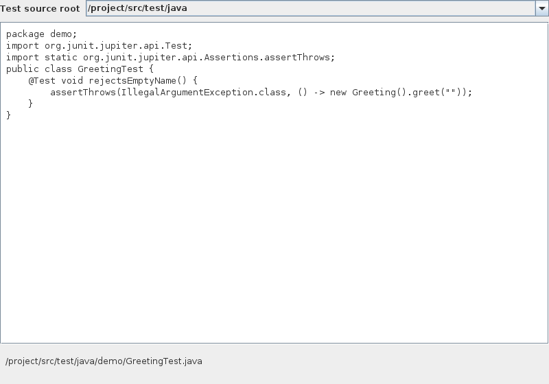
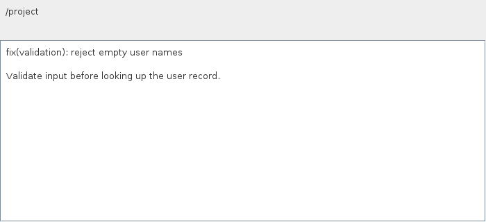
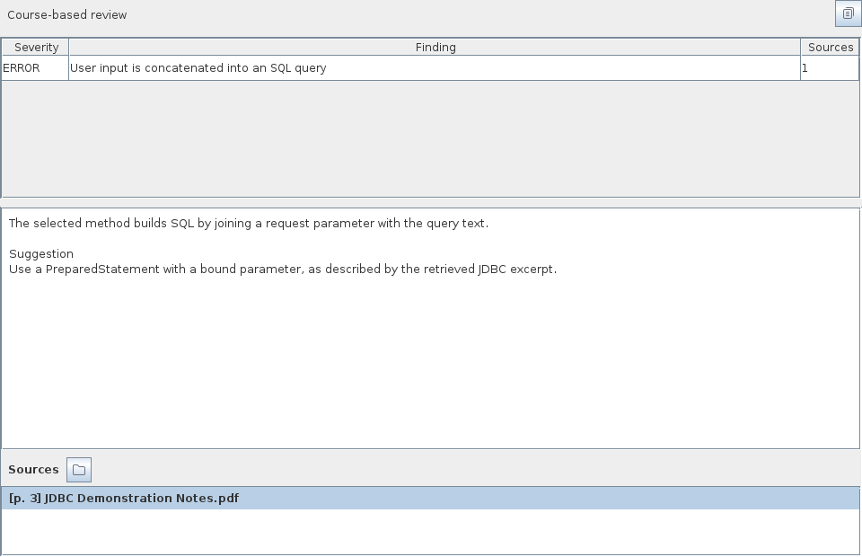
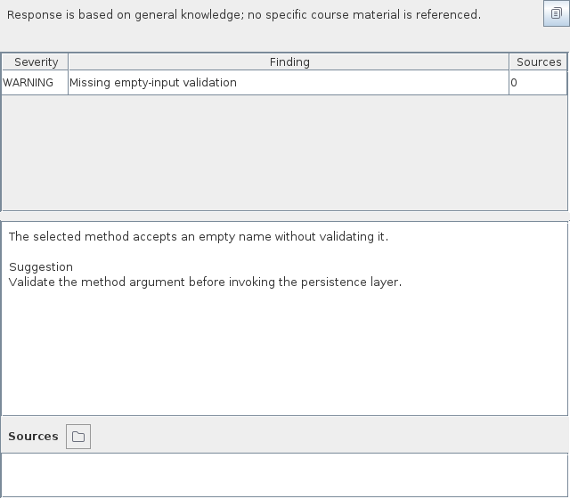
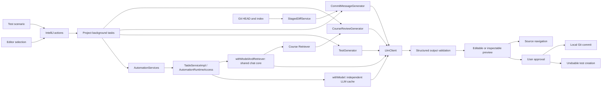

# Automation and Release Technical Notes

## Component Overview

TAIDE's automation component implements the three Group B smart actions: scenario-based JUnit 5 test generation, staged Git commit message generation, and course-aware code review. It runs inside IntelliJ IDEA and consumes the shared `LlmClient`, `Retriever`, and `CodeContext` contracts.

The integration entry point is the project-level `AutomationServices` service. In production it resolves `TaideService` and invokes the `AutomationRuntimeAccess` interface implemented by `TaideServiceImpl`. All three actions are connected as of October 26, 2026 (`main` at `525b9e0`); Windows IDEA end-to-end acceptance remains pending. Background tasks perform model requests and retrieval, while the event-dispatch thread presents results and handles user approval.

`withModel` serves JUnit generation and commit messages from an independent `modelOnly` client cache. It uses the same saved connection settings and PasswordSafe credential lookup as chat, but does not load ONNX or require a course index. `withModelAndRetriever` serves course review from chat's cached `core()` resources, sharing its LLM, retriever, and index. Both callbacks hold a resource lease for their duration and release it on success or failure. These paths share configuration; the model-only cache is not necessarily the same LLM object as chat's cache.

Users save the provider, base URL, model ID, and API key with **Apply** in `Settings > Tools > TAIDE`. Course review and real course Q&A additionally require the prepared `all-MiniLM-L6-v2` embedding files (`model.onnx` and `vocab.txt`), an applied course directory, and **Rebuild Knowledge Base**. Chat's demo switch controls fixed chat examples; the F1 actions use the configured real model independently of that switch. `AutomationServices.bind` remains an optional test or customization hook, not a production setup requirement.

## User Workflows

### Scenario-Based Tests

The user selects a Java class or method, chooses `TAIDE > Generate JUnit Tests...`, and enters a natural-language test scenario in **Generate JUnit Tests** before clicking **Generate**. TAIDE sends the scenario, selected code, enclosing class, package name, and complete current source file to the model. The response contains a complete JUnit 5 test class.

The **Preview JUnit Test** dialog is editable. The selected test source root and parsed Java package determine the destination. After **Save Test**, TAIDE creates the file through an IntelliJ write command and opens it in the editor. Canceling the preview writes no test file. The command participates in IDE undo. Existing files remain protected by the destination check.

JavaParser validates syntax, package consistency, the single public concrete test class, its `Test` suffix, and a JUnit Jupiter `@Test` method. The same validation runs after preview edits. A dependency warning identifies modules where JUnit 5 is absent.

### Git Commit Messages

The user chooses `TAIDE > Generate Commit Message...`, previews the complete staged diff in **Staged Changes**, and clicks **Send to Model**. The model returns a Conventional Commit message with a concise semantic summary and an optional body.

The **Commit Message** dialog supports editing and **Copy Message**. Creating a local commit requires **Commit Staged Files** followed by **Commit** in the confirmation dialog. Immediately before committing, TAIDE checks the index and `HEAD` against the approved snapshot. Git identity, hooks, signing, and repository permissions remain relevant to the commit operation.

### Course-Aware Review

The user chooses `TAIDE > Review Code Against Course...` for a Java selection. TAIDE retrieves up to eight relevant course chunks and displays the **Course-Aware Code Review** dialog. Findings include severity, explanation, suggested correction, and source references. The sources panel displays the document and 1-based page number, and delegates navigation to a source opener captured before the request.

The default project-level `CourseSourceNavigator` captures the applied course directory and works without opening the chat tool window. Later settings changes or rebinding do not replace an existing review's callback. The navigator resolves validated PDF/PPTX files in the captured directory in the background, then uses IDEA's `FileEditorManager.openFile` on the EDT and displays a manual page/slide prompt. Actual preview support depends on the IDE; it does not guarantee launching a Windows external reader or jumping directly to the cited page. A custom `bind` callback may replace this behavior and is responsible for its own context capture.

When retrieval returns no relevant chunks, the review uses general programming knowledge and displays:

> Response is based on general knowledge; no specific course material is referenced.

The review then contains empty citation lists.

## UI Samples

The following samples show the actual Swing preview components rendered by platform tests. Code, model responses, and course references are synthetic fixtures. Wide and compact layouts use the same production components.

### JUnit Preview



The preview presents the generated source, test source root, and resolved destination. Saving uses the edited source after validation.

### Commit Message



The generated summary and body are editable. The dialog provides copying and an explicitly confirmed local commit operation.

### Course Review



The findings table displays severity, title, and source count. The selected finding shows its explanation, suggestion, and original source metadata.



An empty retrieval result produces a visible general-knowledge notice and an empty source list.

## Architecture



The C component owns the automation actions, Git service, previews, build configuration, tests, CI, and packaging tools. The model implementation and RAG pipeline are supplied through A's contracts. B supplies the main plugin descriptor, course assistant UI, and source navigation.

## Data Structures

| Structure | Fields and purpose |
| --- | --- |
| `CodeContext` | File, language, selected text, inclusive 1-based line range, enclosing class |
| `GeneratedTest` | Parsed package, class name, complete source |
| `StagedChanges` | Repository root, complete textual patch, changed-file metadata, snapshot fingerprint |
| `FileChange` | Change type, old path, new path, binary flag |
| `RetrievedChunk` | Document ID, display name, page, excerpt, similarity score |
| `CourseReview.Finding` | Severity, title, explanation, suggestion, original retrieved sources |

The automation layer keeps request and preview state in memory. Course review queries the shared retriever; indexing and index storage are owned by the RAG service and triggered through **Rebuild Knowledge Base**. Generated test files are persisted after approval, and approved commits are stored by Git. The packaging manifest records the source commit, plugin version, and archive-entry SHA-256 values.

## Algorithms and Validation

### Staged Snapshot

JGit compares the `HEAD` tree with `DirCacheIterator`, representing the staging area. An unborn repository uses an empty tree. Rename detection is enabled. Working-tree modifications and untracked files are excluded from the diff input.

Binary files and files larger than 1 MiB use metadata-only diff representations. A bounded output stream limits the full patch to 180,000 bytes, and the change list is limited to 500 files. Requests exceeding either bound receive a split-commit prompt before model submission.

The snapshot fingerprint is:

```text
SHA-256(
    HEAD object ID,
    each indexed path, stage, file mode, and blob object ID
)
```

NUL separators distinguish fields. Including blob IDs detects binary updates even when the textual diff contains only a binary-file notice. The fingerprint is re-evaluated before the explicit commit operation.

### Test Destination

Existing Java test roots have priority. For Gradle source-set modules, TAIDE finds the nearest Gradle or Maven build descriptor and matches test roots belonging to that build module. The fallback is its `src/test/java` directory.

The destination is derived from the parsed package and class name. A normalized containment check, symbolic-link check, and existence check protect the filesystem destination. The VFS operation repeats destination validation inside the write command.

### Citation Integrity

Retrieved chunks receive temporary identifiers such as `S1`. The model receives those identifiers and excerpt text. It returns identifiers inside each finding's `sourceIds` array.

The parser checks every identifier against the retrieved set. Course-mode findings require at least one reference. Document names, pages, snippets, and scores are taken from the original `RetrievedChunk` values. An invented or missing source reference causes a validation error.

This mechanism guarantees that displayed citation metadata belongs to the retrieved set. Human evaluation of explanation relevance and course-rule interpretation remains part of the course-material acceptance test.

## Prompt Engineering

Three resource files define the automation prompts:

- `prompts/automation/junit.md`
- `prompts/automation/commit.md`
- `prompts/automation/review.md`

Inputs use JSON serialization. Prompts treat code, comments, file names, diffs, and course excerpts as untrusted data. The scenario field supplies the intended test requirement. Output is restricted to a complete Java source inside JSON, a Conventional Commit message, or a structured findings array.

Low sampling temperatures favor repeatable outputs. Response-size limits and strict JSON parsing constrain downstream processing. Schema and domain validation run before any persistent operation.

## Responsiveness and Privacy

The project service serializes automation requests. Expensive retrieval, model calls, diff extraction, and Git commits run in background tasks. Result presentation runs on the EDT. Cancellation prevents result presentation and releases the busy state; the model implementation supplies the network timeout and transport cancellation behavior.

The component obtains its model client through the formal project's `AutomationRuntimeAccess` callbacks and contains no API credentials. `TaideServiceImpl` reads the saved provider configuration and PasswordSafe key. The Git workflow provides a diff preview before transmission. The model connectivity tool sends only a synthetic probe and reports status without printing credentials or model response bodies.

## Testing and Delivery

Unit tests cover request construction, invalid model output, citation identity, fallback behavior, generated-test compilation, file-path validation, multi-module build roots, staged-only diffs, initial commits, renames, binary changes, conflicts, and index changes.

Platform tests exercise registered actions, selection metadata, thread transitions, cancellation, VFS creation, undo, service registration, and missing-configuration errors. UI samples are rendered from the actual preview components using synthetic fixtures at wide and compact sizes. Some real-dependency checks return early when keys, model files, or course materials are unavailable, so a passing default build is not evidence that a real-provider workflow ran.

Python tests validate the connectivity probe and submission packager. The packager verifies team information in the report and on the first slide, preserves executable wrapper permissions, separates source and document folders, and produces deterministic ZIP entries with checksums.

CI runs `buildPlugin` alongside tests and structure checks, and invokes IntelliJ Plugin Verifier for the declared platform. It uploads the installable ZIP as a dedicated artifact and fails the upload step if the package is absent. Test reports and UI samples form a separate evidence artifact. A version-tag workflow validates the release version before building and publishing the installable ZIP.

The following numbers are historical component evidence, not current `main` totals: the early C-component verification on WSL2 with JDK 21 and IntelliJ IDEA Community 2024.2.4 passed 61 Java tests and 11 Python tests. Four integration tests executed B's then-existing 53 selection, conversation, citation-path, and settings checks. Plugin structure validation passed, and IntelliJ Plugin Verifier reported `Compatible` for build `IC-242.23726.103`, with three experimental `assertIsNonDispatchThread()` API usages in the settings component. Refer to the CI reports for the exact commit under acceptance for current results.

An opt-in live-model suite covers generated JUnit compilation and execution, a real staged Git diff, course citation integrity, and general-knowledge review. It uses synthetic code and course excerpts with the configured model. `-PliveModelTests=true` enables fresh network requests, while the default build remains repeatable with fixed fixtures. Credentials and the endpoint are supplied through environment variables; generated evidence remains under `build/reports/live-model/`.

The live component acceptance run on October 23, 2026 used `gpt-6-luna` and passed all four cases. Its generated JUnit class compiled and executed four test methods successfully.

The complete integration acceptance run must use the installed plugin, A's configured real model and course index, and B's default navigation callback. The six Windows IDEA scenarios remain `E2E_NOT_RUN` in the [acceptance ledger](../e2e/E2E_RESULTS.md); follow the [execution guide](../e2e/E2E_GUIDE.md) and record the build commit, package hash, tester, and screenshots. This includes compiling and running generated tests, verifying the no-index model path, checking staged-only commits, reviewing real courseware, and opening the correct source file. Earlier live component tests with synthetic excerpts do not establish that Windows GUI acceptance or Tongji AGI-provider verification has passed.

## Presentation Segment

The automation and release segment can occupy approximately four minutes of the team's twenty-minute presentation:

1. Generate an empty-input test for the bundled `GreetingService`, inspect the code, save it, and run JUnit.
2. Stage two changes, leave a separate edit unstaged, preview the staged diff, and generate a Conventional Commit message.
3. Review a JDBC selection against a known course page, inspect a finding, and open its source.
4. Explain the `HEAD`/index comparison, citation-ID validation, user approval, and CI evidence.

The shared presentation should allocate additional time to the RAG pipeline, course Q&A, architecture, collaboration, and the other assignment requirements.
